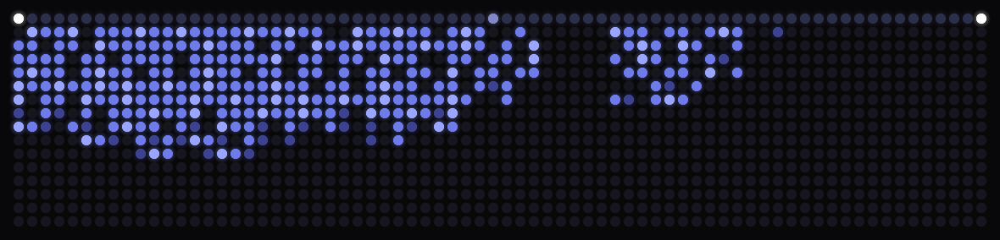
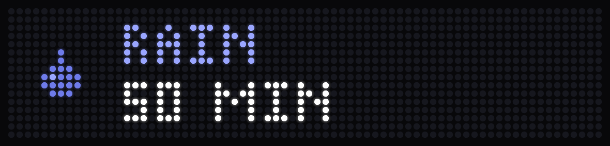

# Buitje for BUSY Bar

The rain ahead for your spot. On the front display rain hangs down from a time axis, sparse for drizzle and dense for a downpour; the wheel sets how far ahead it looks, from the next hour to the next two days. The back display says what is coming in a sentence and shows the 48 hours as a strip.


The next 2 hours, the next 48, and the headline in words:






The back display:


The pictures are BUSY Bar Emulator's screenshots, taken with live rain for Utrecht. The front display's are drawn here as the LEDs they are on the bar; `screenshots/` has them as they were taken, at the displays' size, 72x16 and 160x80.

## Using it

| Control | What it does |
|---|---|
| Wheel | Sets the window: 1, 2, 3, 5, 9, 12, 18, 24, 36 or 48 hours. Left alone for half a minute it goes back to your default. |
| OK | Switches between the timeline and the headline in two lines, such as DRIZZLE IN / 25 MIN. |
| Start | Asks for fresh data. |
| Back | Leaves the app. |

The status light blinks blue when rain is about to start.

### Settings

| Setting | |
|---|---|
| Place | The spot the rain is shown for; Utrecht until you set it. After detecting it automatically, check that it names your town. |
| Window | How far ahead the timeline looks when the app starts. |
| Rain alert | How long before rain the status light blinks: off, or 5, 10, 15 or 30 minutes. |
| Sound with the alert | Off by default. |
| Language | English or Nederlands. |

The app reads its settings when it starts: start it again after a change.

## Where it works

Anywhere, and best in the Netherlands and Belgium.

| Where | What you get |
|---|---|
| The Netherlands, Belgium and a strip around them | The next 2 hours from the rain radar, in steps of 5 minutes for your square kilometre; then weather models, by the quarter of an hour up to 6 hours ahead and by the hour for the 2 days after. |
| The rest of central Europe, with Denmark and southern England | Weather models: the next 6 hours by the quarter of an hour, then by the hour. |
| The rest of the world | Weather models: all 48 hours by the hour. Showers are placed less precisely. |

The app finds out by itself which of these it is in. The last line of the back display names the sources in use.

## Where the rain comes from

- **The radar:** KNMI's precipitation nowcast, which follows the showers the Dutch radars see now for the next 2 hours. KNMI publishes it as a picture of the whole country; a small relay made for this app, at `buitje.kootstra.io`, reads those and answers a bar with the numbers for its place. It is sent the place's coordinates, rounded to a kilometre, and nothing else.
- **The models,** through [Open-Meteo](https://open-meteo.com): KNMI's HARMONIE by the hour where it reaches (2 km in the Netherlands and Belgium, 5.5 km in central and northern Europe) and other models elsewhere, and DWD's ICON-D2 by the quarter of an hour for the first 6 hours.

Where the radar reaches, the first 2 hours are the radar's, also when it says dry and a model says rain: the radar sees the showers there are. Where the two models disagree, the app shows the stronger rain of the two: rain that is shown and does not come costs less than rain that comes unannounced.

When the relay does not answer, the app asks KNMI's own map service for the same radar, which gives it in steps of 10 minutes. When that does not answer either, the app shows the models and says nothing: they are a forecast, so a shower can then come earlier or later than shown, and a small one can be missed. That goes for the rain alert too. All of the data is under CC BY 4.0.

The bar needs Wi-Fi. Without it the app says so and waits; when the connection drops it keeps showing what it had, marked as old and with the time it is from, for up to 3 hours.

## Building and running

Node 22 or later.

```sh
npm install
npm run build        # dist/io.kootstra.buitje.tgz
npm run app:install  # onto a BUSY Bar connected over USB
npm run app:run
```

Without a BUSY Bar, [BUSY Bar Emulator](https://github.com/busy-app/busybar-emulator) runs it: `busy-emulator dev --once` from this folder.

```sh
npm test       # the series, the headline, the settings, and the built app on a pretend bar
npm run bench  # how long the bar takes for a frame of every kind (needs the emulator running)
```

[AGENTS.md](AGENTS.md) says where each part of the code is and what was measured on the bar.

## License

[MIT](LICENSE)
